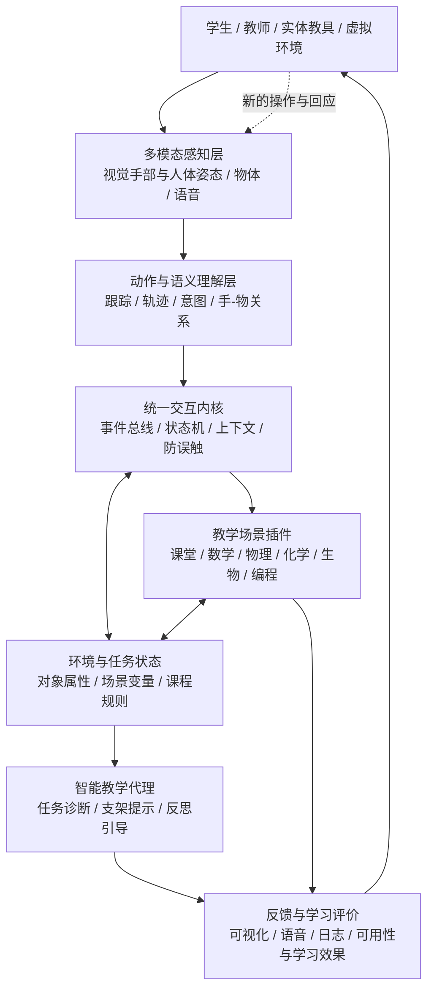

# EmbodiedEdu · 灵境智学

## 基于多模态感知与具身交互的自适应智能教育平台——总体设计方案

> **文档版本**：V1.0（项目概念与技术总体设计）  
> **整理日期**：2026 年 10 月 12 日  
> **项目定位**：《人机交互技术》课程大作业 → 可持续迭代的完整软件项目 → 科研与求职作品集  
> **英文建议名**：*EmbodiedEdu: An Adaptive Multimodal Interaction Platform for Embodied Learning*  
> **文档状态**：规划方案；功能、效果和性能指标均为拟实现或拟验证目标，不表示已经完成。

---

## 0. 执行摘要

本项目拟构建一个面向智慧教育的**具身学习（Embodied Learning）多模态智能交互平台**。以普通摄像头为主要感知设备，融合计算机视觉、手势与人体动作识别、实物感知、语音交互、三维可视化、学习状态建模以及 AI 教学引导，让学生通过**身体动作、真实教具和虚拟学习对象**主动探索知识，并让计算机理解其操作过程、提供可解释的实时反馈。

**一句话定义**：让学生通过动作与环境“表达思考”，让 AI 通过感知、理解和反馈“参与学习”，而不仅是用手势替代鼠标。

平台采用“**一个交互内核 + 多种输入模态 + 可插拔学科场景 + 教学反馈闭环**”的架构：

- **基础入口**：手势 PPT 演示、隔空白板、媒体控制、交互状态提示、自定义手势映射。
- **学科应用**：数学空间几何、物理力学与光学、化学分子结构、生物生态系统、计算机算法与实体编程等。
- **智能内核**：多模态感知、动作语义解析、对象与场景状态、交互状态机、错误预防、学习过程建模和自适应反馈。
- **长期延伸**：在可验证的虚拟环境中引入能感知、规划、执行、观察结果的教学智能体，进一步探索“具身智能（Embodied AI）”能力；更远期再考虑实体机器人。

**建议第一版（MVP）**：通用手势控制 + 隔空白板/PPT + **一个完整的空间几何学习场景** + 简化的引导反馈；物理场景先做轻量验证，切忌首版铺满所有学科。课程交付重点是**能运行、能演示、能评价、架构能扩展**。

---

## 1. 项目背景、需求与价值

### 1.1 背景与问题

当前不少数字教学工具以“屏幕显示内容—用户点击按钮—系统显示结果”为主，存在以下机会：

1. **抽象知识难以直观理解**：空间截面、力与加速度、分子结构、程序流程等知识，仅靠文字与静态图片较难形成空间直觉。
2. **真实操作与数字反馈脱节**：学生做实验、摆放实体卡片时，计算机未必理解操作到哪一步、为什么犯错。
3. **智能教学过度集中于文字问答**：即使接入 LLM，系统往往仍不知道学生刚刚如何操作环境。
4. **技术演示容易成为功能堆砌**：单独的手势 PPT、空中画板、分子拼接等 Demo 缺少共享的行为理解和教学决策机制。
5. **学习效果不容易评估**：关注“手势能否识别”多，关注“交互是否降低负担、是否帮助理解”少。

### 1.2 目标用户与任务

| 角色 | 主要需求 | 核心使用过程 |
|---|---|---|
| 学生 | 动手理解抽象概念、得到及时且不过度代答的反馈 | 探索 → 预测 → 操作 → 观察 → 反思 |
| 教师/助教 | 控制教学内容、发起实验、观察课堂任务完成情况 | 演示 → 布置任务 → 引导 → 回顾 |
| 课程内容作者 | 低成本新增教学场景 | 定义场景对象 → 规则 → 交互映射 → 反馈 |
| 研究人员/开发者 | 研究交互机制及学习效果，复现实验 | 收集授权数据 → 对比条件 → 统计分析 |

### 1.3 项目目标与非目标

**近期目标（课程阶段）**：完成稳定的手部追踪与交互状态管理；提供 PPT/白板基础应用；打造一个可完成完整教学任务的学科场景；记录交互事件并开展小规模可用性测试。

**中期目标（平台阶段）**：形成统一交互 API、插件机制、用户校准、自适应引导与第二学科实例，具有可部署、可测试和可维护的工程质量。

**远期目标（科研阶段）**：研究多模态动作—对象关系理解、自适应交互及智能教学策略；逐步让虚拟教学智能体具有主动操作仿真环境的能力。

**明确非目标**：首版不追求覆盖所有学科、不宣称替代教师、不直接诊断学生认知能力、不以单目摄像头宣称可精确测量任意三维空间、不过早训练通用具身大模型或购买复杂实体机器人。

---

## 2. 理论基础：HCI、具身学习与具身智能如何联系

### 2.1 三个必须区分的概念

| 概念 | 关注重点 | 本项目体现 |
|---|---|---|
| **具身认知（Embodied Cognition）** | 认知与身体、感觉运动过程和环境相联系 | 通过移动、旋转、抓取建立空间或物理概念 |
| **具身学习（Embodied Learning）** | 让身体动作和真实环境操作成为学习活动的一部分 | 手势操作三维图形、实体卡片编程、真实光影实验 |
| **具身智能（Embodied AI）** | 智能体通过感知—行动与环境闭环耦合 | AI 导师在虚拟实验中观察、规划、操作、验证并调整 |

**严格定位**：MVP 首先是“面向具身学习的多模态智能人机交互平台”。如果 AI 仅负责聊天和生成提示，不能直接称为已实现完整具身智能。后续引入具有环境操作能力和闭环行动的虚拟代理后，才形成更明确的 Embodied AI 研究对象。

### 2.2 四个演进层级

- **L1：手势作为输入**。挥手翻页、食指画线、捏合点击——属于视觉交互工具。
- **L2：动作作为学习活动**。双手旋转截面、用身体位移画函数、操作真实积木——体现具身学习。
- **L3：系统理解学习过程**。识别正在操作的对象、任务阶段、预测与实际结果之间的差异，选择反馈策略——体现智能教学交互。
- **L4：AI 主动与环境交互**。虚拟导师能演示、操作、观察、修正策略；将来可扩展到实体设备——更接近具身智能。

### 2.3 应遵守的人机交互理论

| 理论或原则 | 设计要求 | 示例 |
|---|---|---|
| 直接操作（Direct Manipulation） | 可见对象、连续操作、可逆动作 | 手势拖动立体几何体、松手释放 |
| 自然映射（Natural Mapping） | 输入动作与功能语义对应 | 双手距离变化对应放大/缩小 |
| 反馈与可见性（Feedback / Visibility） | 实时显示系统是否识别、正在执行什么 | 手势锁定图标、选中高亮、预览轨迹 |
| 可供性与指示符（Affordance / Signifiers） | 用户知道哪些对象可操作及如何操作 | 几何体显示旋转手柄和提示 |
| 错误预防与恢复 | 限制误触，允许撤销与重试 | 激活区、持续确认、冷却、撤销 |
| 认知负荷控制 | 不让复杂手势遮蔽学习目标 | 核心动作少、模式明确、支持鼠标替代 |
| 用户中心设计（UCD） | 用真实任务和用户测试迭代 | 任务完成率、SUS、访谈、主观负荷 |
| 情境感知与自适应 | 同一意图在不同任务中映射为恰当操作 | “拖动”在几何课移动切面，在物理课移动支点 |
| 探究式学习与支架式引导 | 鼓励预测、试验和反思，不直接代答 | 先问预测，再呈现结果和追问 |

> **设计判断标准**：手势不仅要“能识别”，还应当与任务语义有关；如手势旋转几何体是自然映射，设计三个无意义的组合手势来打开习题则可能增加负担。

### 2.4 研究基础

- 卡内基梅隆大学的 **NoRILLA** 是重要参考：以现实物理实验和计算机视觉为入口，用虚拟导师提供实时引导，表明“真实操作 + 数字反馈”是一条可研究的教育交互路线。
- 2025 年一项涵盖 **46 项研究、66 个效应量**的具身学习元分析，整体报告中等正向学习效果（Hedges' \(g=0.406\)，95% CI [0.264, 0.548]）。这不能推断本项目必然有效，具体方案仍须进行用户实验。
- 该项目的科研价值并非“用了手势/LLM”，而是能够检验**动作与知识映射、任务反馈策略以及教学成果**之间的关系。

---

## 3. 产品形态与应用场景总体规划

### 3.1 基础工具层：智慧课堂工作台

这些功能承担入口与基础交互能力，**不是核心科研创新本身**。

| 功能 | 交互形式 | 技术或设计重点 |
|---|---|---|
| PPT/教学内容控制 | 左右滑动、确认手势、语音切换 | 误触防护、模式指示、权限控制 |
| 隔空书写/智能白板 | 指尖轨迹、捏合绘制、撤销 | 轨迹平滑、书写/移动模式切换 |
| 虚拟激光指示 | 食指指向 | 坐标映射、指针抖动抑制 |
| 媒体控制 | 播放、暂停、音量 | 操作反馈、和其他手势冲突处理 |
| 智能控制面板 | 模式切换、自定义映射 | 可见性、学习成本、可访问性 |
| 语音辅助 | 切换场景、询问讲解 | 任务上下文、明确确认 |
| 课堂/学习记录 | 记录操作序列、任务结果 | 数据最小化、可追溯和隐私设置 |

### 3.2 学科插件层：建议优先场景

| 学科插件 | 示例学习任务 | 具身输入 | 智能反馈方向 |
|---|---|---|---|
| **数学·空间几何** | 正方体旋转、平面截面、展开图 | 单/双手移动、旋转、缩放 | 截面变化、顶点与面积、概念追问 |
| **数学·函数** | 身体位移绘制函数、理解速度—位移 | 手掌或身体轨迹 | 对比目标曲线、解释变量关系 |
| **物理·力学** | 受力分析、运动预测、杠杆平衡 | 调整力矢量、移动支点/重物 | 模拟轨迹、平衡判定、预测差异 |
| **物理·光学** | 真实光源与影子变化、透镜成像 | 移动手电筒/实物或虚拟光源 | 几何标注、影长变化、实验提示 |
| **化学·分子** | 构建少量已知分子结构 | 拖动原子、连接键 | 结构规则约束与三维展示 |
| **生物·微观结构** | 细胞结构组合与层级探索 | 拆解、放大、拼装 | 结构关联解释 |
| **生物·生态** | 构建食物网、观察物种变化 | 实体物种卡片、关系连接 | 简化模型仿真与因果追问 |
| **计算机·编程** | 体感排序、路径规划、实体卡片编程 | 移动节点、排列带标记卡片 | 程序执行轨迹与错误定位 |

### 3.3 面向后续扩展的创新场景池

此前讨论的创意可以全部进入 **Backlog（场景储备池）**，但不应全部加入 MVP：

1. **影子实验室**：现实光影 + 摄像头轮廓识别 + 投影与相似三角形分析。
2. **积木力学侦探**：搭建实体结构，观察稳定性，按已知标准积木参数解释重心与支撑区。
3. **实体代数天平**：实物卡片表达方程两侧，操作后验证等式是否保持成立。
4. **人体函数绘图仪**：用运动轨迹生成函数，探索变化率与图像。
5. **AI 节奏指挥家**：身体指挥节拍，实时反馈时间偏差。
6. **智能书写镜**：追踪笔尖过程，练习笔顺/作图并显示轨迹差异。
7. **科学论证桌面**：通过假设卡、证据卡、质疑卡构建可视化论证网络。
8. **历史时空推演桌**：实体历史事件卡片联动时间轴、地图与逻辑关系。
9. **双人信息差实验**：两名学生分别控制实验不同部分，研究协作、权限和冲突解决。
10. **手语入门交互镜**：限定词汇与手形练习，对比动作并反馈；不宣称完整手语翻译。
11. **反向教学 AI**：学生通过操作教会虚拟机器人完成一个明确任务，机器人执行并反问。
12. **生态系统推演桌**：摆放实体物种卡片构建食物网，按简化模型观察变量变化。
13. **纸笔指向辅导**：指向纸面题目局部，系统识别相关区域并提供解释；初版须控制识别范围。
14. **三维化学/生物模型探索**：可抓取和拆解的虚拟对象 + 课程任务规则。
15. **智能实验/装配辅助**：识别手—工具—元件操作与步骤状态，给出操作提示。

**场景入选原则**：真实教学痛点明确、动作与知识语义有关、普通摄像头可稳定演示、结果可验证、可设计对照实验、能够复用平台内核。

### 3.4 为什么优先选“空间几何 + 力学”

- **空间几何**主要验证虚拟对象直接操作、空间映射和连续视觉反馈，可做出清晰的 3D 演示。
- **力学探索**主要验证动作映射到物理参数、仿真规则、预测—实验—反思的学习闭环。
- 两者共用手势和交互语义内核，却具有不同的教学规则，能够证明插件架构的可扩展性。
- 化学、生物、实体编程等作为后续场景，有明确技术积累路径。

---

## 4. 总体系统架构

### 4.1 设计原则

**一套感知层、一套语义事件层、一套交互状态机、多套学科插件和教学反馈策略。** 避免在每个学科里重新训练或复制一套手势脚本。



### 4.2 第一层：多模态感知 Perception

输入来源：摄像头（手部关键点、人体姿态、实物/标记）、麦克风（语音命令）、应用状态（当前学科和对象）；后期可加入深度相机、触觉设备或机器人传感器。

关键能力：多手跟踪、坐标归一化、采样时间戳、光照和遮挡处理、识别置信度、识别失效处理。识别失败应优先进入安全的空闲状态，而非继续执行上一次危险指令。

### 4.3 第二层：动作与意图理解 Understanding

将视觉坐标变成可操作的语义：

- **静态手势**：张开手掌、握拳、指向、捏合等。
- **动态手势**：滑动、连续拖拽、双手张合、指尖轨迹等。
- **目标关联**：手势操作的是哪个对象？是否处于允许交互区域？
- **上下文消歧**：在白板模式“指尖移动”为画线；几何模式“指尖移动”为拖动选中对象。
- **用户适应**：校准手掌尺度、操作范围、灵敏度，支持不同用户动作幅度。

初版优先采用“**MediaPipe 关键点 + 几何规则/状态机**”；需要动态手势或自定义类别时，再添加可训练的分类器（如轻量 MLP、LSTM 或 TCN），避免一开始引入不必要的模型复杂度。

### 4.4 第三层：统一交互内核 Interaction Core

核心职责：

1. 从原始识别结果生成统一语义事件（例如 `select`、`drag`、`rotate`、`scale`、`draw`、`confirm`、`cancel`）。
2. 管理状态：**未激活 → 已激活 → 已选中 → 操作中 → 完成/取消**。
3. 管理触发防护：意图确认、动作持续时间、阈值滞回（hysteresis）、冷却时间、交互区域、失手保护。
4. 管理“谁在控制、控制哪个对象、使用哪个模式”，避免多模态命令冲突。
5. 将事件分发给当前学科插件，记录经过授权的必要交互元数据。

**统一语义映射示例**：

| 输入动作 | 统一事件 | 数学 | 物理 | 化学 | 编程 |
|---|---|---|---|---|---|
| 指向并停留 | `point` / `select` | 选切面 | 选力矢量 | 选原子 | 选节点 |
| 捏合+移动 | `drag` | 移切面 | 移支点 | 拖原子 | 拖模块 |
| 双手拉开/合拢 | `scale` | 缩放视图 | 调参数范围（需显式提示） | 缩放模型 | 缩放工作区 |
| 手掌旋转 | `rotate` | 旋转几何体 | 旋转作用力方向 | 旋转分子视图 | 可选，无需强制复用 |
| 挥手并确认 | `next` | 下个任务 | 下个实验步骤 | 下个挑战 | 下个关卡 |

同一动作**不必强行在所有场景拥有同样含义**。应统一的是语义协议、反馈与状态管理，而不是制造不自然的操作映射。

### 4.5 第四层：场景/任务状态 World & Task Model

保存可验证的世界状态：当前学科、场景对象、对象属性、物理参数、任务进度、用户选择及操作历史。数学和物理计算由规则引擎/仿真负责，不依赖大语言模型“猜”出结果。

- 数学：几何形状、切割平面、变换矩阵、交线等。
- 物理：位置、速度、质量、施力、加速度、碰撞或简化约束。
- 编程：卡片顺序、语法树、执行状态。
- 教学：已做的预测、错误类型、使用的提示等级及任务完成情况。

### 4.6 第五层：智能教学代理 Pedagogical Agent

采用“**可验证规则 + 教学策略 + LLM 自然语言表达**”的组合：

1. **观察**：读取场景状态与动作事件；
2. **判断**：使用任务规则识别错误或预测—结果差异；
3. **决策**：选择不打断操作、提示关键观察、提出苏格拉底式问题、给出示范或结束任务；
4. **反馈**：可视化提示、语音/文本，保留撤销和人工接管；
5. **复查**：观察学生新的操作与答复，更新任务状态。

**提示策略**：默认从轻到重——状态提醒 → 问题引导 → 局部提示 → 示例演示 → 必要时明确答案。避免连续输出长篇解释、过早代答或在识别不确定时臆断学生意图。

### 4.7 第六层：反馈、评价与持续优化

- **即时反馈**：当前手势、识别状态、选中对象、允许操作、结果预览。
- **认知反馈**：预测与观察对比、错误解释、下一步探究提问。
- **用户模型**：记录显式操作偏好、任务完成表现和反馈历史；不把少量交互行为等同于真实能力诊断。
- **评价工具**：任务事件时间线、误触次数、任务达成情况、前后测、体验问卷。

---

## 5. 重点场景设计：MVP 从一个完整学习任务做起

### 5.1 智慧课堂基础入口（基础完成度展示）

**演示流程**：摄像头识别用户 → 激活操作区域 → 手势切换 PPT → 食指指示重点 → 切换隔空白板并画出简单图形 → 撤销 → 返回主界面。

工程难点：手指定位稳定、操作模式明确、避免自然讲课动作误触；此模块不承担核心科研创新。

### 5.2 数学·空间几何（第一核心场景）

**教学问题**：“用平面切割正方体，可以形成哪些截面？不同切面位置和方向为何会改变形状？”

**典型交互流程**：

1. 学生选择正方体并预测截面可能出现的边数。
2. 通过单手拖动控制切割平面位置，或在明确的模式下旋转切割平面。
3. Three.js 实时渲染几何体、切割平面与截面；后台几何算法计算交点和多边形。
4. 系统显示截面顶点、面积等由算法计算的量，以及当前状态。
5. 学生对比自己预测与真实计算结果，AI 给出问题式引导。
6. 学生重复操作并提交解释；任务记录用于后续分析。

**初版范围**：一个正方体、一个切割平面、若干典型截面与任务卡片。单目摄像头只用于二维控制信号，系统通过明确的模式将其映射至三维操作；不声称精确恢复真实手掌六自由度。

**成功判据**：对象能稳定选中和控制；截面结果可复现；学生可以完成预设探究任务；错误操作可撤销。

### 5.3 物理·力与运动（第二个轻量验证场景）

**教学问题**：“施力方向改变后，物体的速度和加速度如何变化？”

**典型交互流程**：提出运动预测 → 用手势改变力矢量 → 仿真运行 → 显示位置、速度和加速度方向 → 对比预测 → AI 追问。

**作用**：不追求复杂 3D 物理引擎；优先使用可解释的二维牛顿运动模型，并展示“同一交互内核复用到另一套学科规则”。

### 5.4 长期代表性场景：反向教学虚拟机器人

学生通过手势示范如何调整杠杆支点或构造稳定结构；虚拟 AI 代理读取环境状态，执行一个受限动作，观察模拟结果，再询问学生原因或尝试下一步。

要求具备真实的**观察—规划—执行—校验闭环**；否则仍应称为“虚拟教学角色”，而非已实现具身智能体。可以先做基于规则/工具调用的虚拟代理，再研究学习策略和可泛化的控制方法。

---

## 6. 数据与插件接口设计

### 6.1 原始感知与交互语义分离

不要让学科代码直接依赖摄像头坐标。采用两层事件：

**（A）感知结果**：手部关键点、左右手、跟踪标识、原始置信度、时间戳、摄像头来源等。

**（B）语义交互事件**：高层动作、对象、场景上下文、阶段、位置、置信度和确认状态。

统一事件示例（**字段和数值均为设计示例**）：

```json
{
  "event_id": "evt_000123",
  "timestamp_ms": 183420,
  "scene_id": "geometry_cube_section",
  "actor_id": "user_local_1",
  "source": "right_hand",
  "intent": "drag",
  "phase": "update",
  "target_id": "cutting_plane_01",
  "position_norm": [0.42, 0.61],
  "confidence": 0.94,
  "confirmed": true
}
```

- `phase` 可为 `start/update/end/cancel`，便于管理连续拖拽。
- `position_norm` 为归一化界面坐标，不等于真实三维位置。
- 日志默认只记录非敏感操作元数据；原始图像/音视频必须有单独授权与保存策略。

### 6.2 学科插件契约（伪代码）

```python
class LearningScenePlugin:
    scene_id: str

    def initialize(self, config: dict) -> None: ...

    def get_world_state(self) -> dict: ...

    def handle_interaction(self, event: dict) -> dict: ...

    def evaluate_task(self, state: dict) -> dict: ...

    def get_feedback_context(self, state: dict) -> dict: ...

    def reset(self) -> None: ...
```

**原则**：学科插件只处理“拖动切面”“改变力矢量”等有意义的事件，不能自己直接操纵摄像头；这样有利于跨学科复用、单元测试和日志回放。

### 6.3 数据存储规划

- **SQLite**：MVP 的用户配置、任务结果、事件日志，最容易部署。
- **可选 MongoDB**：中期如需要灵活保存不同学科的异构事件、实验过程或用户偏好，可引入；不是首版必需。
- **数据组织**：匿名用户标识、场景、会话、事件、任务尝试、提示历史、反馈问卷；原始视频与事件日志分离管理。

---

## 7. 技术栈与工程实现

| 层次 | 推荐方案 | 选用理由或注意事项 |
|---|---|---|
| 视频采集 | Python + OpenCV | 普通 USB/笔记本摄像头，便于原型开发 |
| 手/人体跟踪 | MediaPipe Tasks | 官方提供手部关键点、手势识别等任务；注意不同版本 API 区别 |
| 物体感知 | OpenCV ArUco、必要时 YOLO | 实体卡片优先用 ArUco，目标检测按场景增加 |
| 动态识别 | 轨迹规则 → MLP/LSTM/TCN | 从轻到重，引入可训练模型前先建立基线 |
| 后端 | FastAPI + WebSocket | 低复杂度实现服务与实时事件推送 |
| 桌面/网页界面 | React + TypeScript | 控制台、白板、学习任务和配置界面 |
| 三维渲染 | Three.js | 数学与仿真交互，可复用对象和相机控制 |
| 数学/物理 | 自定义可验证几何与动力学规则 | 结果应由计算确定，不由 LLM 臆造 |
| 教学策略 | 规则引擎 + 可选 Qwen/其他 LLM | 规则判正确性，模型组织自然语言与追问 |
| 数据库 | SQLite → 按需 MongoDB | 避免过度设计 |
| 部署测试 | `venv`/Conda、pytest、前端测试、Docker 可选 | 锁定依赖、可复现运行流程 |

**重要工程建议**：

- 优先 **单体后端 + 清晰模块**；不宜从第一天微服务化。
- 同一机器上可优先让 Python 处理视频与手势，只通过 WebSocket 发送轻量事件给网页，避免反复传输完整视频。
- 为避免延迟累积，允许视觉模块丢弃过时视频帧并保留最新状态；记录端到端交互延迟。
- MediaPipe 的静态/视频/直播模式接口不同，需要按官方文档实现时间戳与回调逻辑。
- 系统始终保留鼠标/键盘作为替代输入方式，不能要求用户只能用手势。

### 7.1 建议目录结构

```text
EmbodiedEdu/
├── frontend/
│   ├── classroom/          # PPT / 白板 / 控制台
│   ├── scenes/             # 数学 / 物理 / 未来插件
│   └── dashboard/          # 任务与评价界面
├── backend/
│   ├── perception/         # 摄像头、手部、实物与语音感知
│   ├── gesture/            # 特征处理、识别、平滑、校准
│   ├── interaction/        # 语义事件、状态机、路由和防误触
│   ├── world_model/        # 场景、对象与任务状态
│   ├── tutoring/           # 教学决策、规则与 LLM 接口
│   ├── plugins/            # 学科逻辑插件
│   └── api/                # FastAPI / WebSocket
├── models/                 # 模型与配置（大文件按规则管理）
├── datasets/               # 经授权收集与脱敏的数据
├── experiments/            # 实验脚本、统计与消融
├── tests/                  # 功能与回归测试
├── docs/                   # 设计、使用和研究文档
├── scripts/                # 安装与运行脚本
└── README.md
```

---

## 8. 开发路线与交付边界

### 阶段 I：课程大作业 MVP（建议按 4—6 周规划，非交付承诺）

| 工作包 | 最小成果 | 验收要点 |
|---|---|---|
| A. 感知与手势 | 摄像头、关键点、选中/拖动/释放、平滑 | 操作可连续完成，识别丢失可安全恢复 |
| B. 基础课堂 | PPT 翻页、指示、白板画线与撤销 | 模式清晰，不随意误触 |
| C. 统一内核 | 事件对象、状态机、事件分发 | 不依赖单一学科逻辑 |
| D. 核心场景 | 正方体与切割平面的连续交互 | 截面算法可测、任务闭环完整 |
| E. 智能反馈 | 至少一类规则驱动的错误提示和探究性问题 | 反馈与任务状态一致 |
| F. 评价与交付 | Demo 视频、README、性能测试、简要用户研究 | 他人按步骤能运行或复现演示 |

**保底方案**：如果进度紧张，优先保住统一交互内核 + 完整几何教学任务 + 基础防误触 + 实验评价；物理模块、语音/LLM、复杂可视化可后移。

### 阶段 II：平台化（后续 2—3 个月的建议工作量）

- 正式稳定插件接口；实现物理学科完整任务与至少一个实体桌面任务；
- 自定义手势与用户校准；多模态输入协调；
- 对外提供场景开发文档，形成可扩展代码组织；
- 引入学习任务状态、提示等级与学习日志；
- 性能分析、自动化测试、版本化发布、安装脚本；
- 对隐私、数据权限、第三方依赖许可证进行规范化管理。

### 阶段 III：科研扩展（持续迭代）

- 自建手势—对象—任务状态小型数据集；
- 研究动态手势、意图与手—物关系识别；
- 在不同学科评估同一交互机制的迁移；
- 自适应教学反馈对任务表现与学习结果的影响；
- 开发能够调用场景工具执行实验的虚拟教学智能体；
- 若确有研究价值，再引入深度相机、空间设备或实体机器人。

---

## 9. 研究问题、实验设计与评价

### 9.1 三条可持续科研主线

**R1. 多模态动作与操作意图理解**  
如何融合手部关键点、轨迹、被操作对象、场景上下文，减少相似动作误分类与非意图触发？

**R2. 自适应具身交互**  
用户动作幅度、速度和使用习惯不同，个性化校准与状态机能否降低错误率和交互负担？

**R3. 具身学习与智能教学反馈**  
使用学生的动作过程及实验状态生成反馈，能否优于只根据最终答案或固定提示的教学方式？

### 9.2 核心对照实验

**基础三组方案**：

1. 鼠标操作 + 固定教学反馈；
2. 手势操作 + 固定教学反馈；
3. 手势操作 + 自适应教学反馈。

可比较手势输入本身、增加自适应反馈后的结果差异。但三组设计无法完整估计“输入方式 × 反馈方式”的所有交互效应。

**更严格的四组设计（资源允许时）**：

| | 固定反馈 | 自适应反馈 |
|---|---|---|
| 鼠标输入 | A | B |
| 手势输入 | C | D |

建议对相近能力的参与者做适当随机分组或平衡任务顺序；避免因任务难度、首次学习、操作疲劳等造成偏差。

### 9.3 技术与 HCI 指标

| 维度 | 具体指标 | 含义 |
|---|---|---|
| 感知 | 手势分类准确率、混淆矩阵、漏检/误检 | 是否能稳定理解动作 |
| 交互 | 每任务误触次数、撤销次数、成功率 | 系统是否可控 |
| 实时性 | 端到端响应延迟、帧率、抖动 | 互动是否连续 |
| 效率 | 任务完成时间、操作次数 | 是否比对照方式更高效 |
| 可用性 | SUS、访谈、学习成本 | 使用体验如何 |
| 负担 | NASA-TLX 或简化的主观负荷问卷 | 是否增加体力或认知负担 |
| 学习 | 知识前测/后测、延迟测验（可选）、解释质量 | 是否促进概念理解 |
| 自适应 | 校准前后误触、完成时间与稳定性 | 个性化是否有效 |

**性能目标建议**：在第一轮测试后再设置具体目标值，避免未经测量就写“99% 识别率”或“毫秒级延迟”。正式论文中需区分“性能指标”“验证环境”和“实际测量结果”。

### 9.4 消融实验建议

- 去掉时间确认机制，观察误触变化；
- 去掉轨迹平滑，观察光标抖动与完成时间；
- 去掉任务上下文，观察意图冲突；
- 去掉个性化校准，观察不同用户差异；
- 去掉基于操作过程的反馈，只保留最终结果提示，观察学习行为变化。

---

## 10. 难点、风险与边界

| 风险 | 表现 | 应对策略 |
|---|---|---|
| 手势抖动与误触 | 无意动作触发操作 | 状态机、滞回、持续确认、冷却、交互区域 |
| 摄像头遮挡与光照 | 关键点追踪不稳 | 现场校准、合理机位、丢失即暂停 |
| 单目空间信息不足 | 难以精确恢复 3D 手位姿 | 采用受约束的 2D→3D 映射，必要时升级硬件 |
| 学科判断出错 | 模型解说与数学/物理结果冲突 | 确定性仿真与规则检验优先，LLM 只表达与引导 |
| 功能过多 | 每个模块都只有简单 Demo | 严格分期、完成一个完整教学闭环再扩展 |
| 学生手臂疲劳 | 长时间悬空操作不舒适 | 缩短手势使用时长、低幅度动作、替代输入 |
| 数据与隐私 | 摄像头画面涉及个人信息 | 本地优先、默认不录制、单独授权、匿名化与删除策略 |
| 儿童教育场景 | 需要更严格的授权和安全设计 | 课程初期以成年同学试用为主；涉及未成年人遵循相关规定 |
| 依赖兼容性 | 老项目版本过旧 | 以官方接口和固定环境为基础，不无条件照搬旧仓库 |
| 学习效果归因 | “好玩”不代表“学得好” | 设对照、明确指标、记录局限与可能混杂因素 |

---

## 11. 项目创新点与差异化定位

### 11.1 核心创新并非功能数量

建议把创新价值收敛为四点：

1. **动作与知识概念的自然映射**：学生通过直接操作可见对象理解抽象知识，而非仅通过手势触发快捷键。
2. **跨学科统一交互语义内核**：感知、状态与反馈可复用，降低新增学科的开发成本。
3. **感知学习过程的自适应引导**：结合操作轨迹、环境状态、预测与结果，提供有依据的教学反馈。
4. **虚实闭环与具身智能体的渐进路线**：从人操作环境，发展到 AI 可以操作可验证的虚拟环境，并与学生协作。

### 11.2 与其他系统的定位差异

| 常见方案 | 主要功能 | 本项目计划中的不同点 |
|---|---|---|
| 手势虚拟鼠标 | 隔空点击与控制 | 以学习任务、知识映射和教学反馈为核心 |
| 单学科三维 Demo | 展示几何/分子 | 统一交互协议和跨学科插件机制 |
| 纯聊天 AI 导师 | 文本/语音问答 | 能读取学生动作和场景状态 |
| 传统实验仿真软件 | 操作屏幕上的参数 | 增加身体动作、实物操作和探究式反馈 |
| 纯机器人具身智能 | 机器人在环境中行动 | 聚焦教育交互、人机协作与学习评价 |

---

## 12. 课程答辩、科研产出与面试展示

### 12.1 推荐的 90 秒演示脚本

1. **0—15 秒**：打开课堂控制台，展示摄像头识别到手势并进入已激活状态。
2. **15—30 秒**：手势翻页、指示内容、隔空白板画线并撤销。
3. **30—65 秒**：切换“空间几何”，抓取正方体并移动切割平面，展示实时变化的截面与计算结果。
4. **65—80 秒**：学生提交一个错误预测，系统基于任务规则给出问题式引导。
5. **80—90 秒**：展示底层统一事件、模式切换与操作日志，说明如何扩展物理等新插件。

**演示重点**：让评委看到“视觉输入 → 语义操作 → 知识现象变化 → 智能反馈”，而不只是高光视频。

### 12.2 项目交付物

- 可运行项目源码、依赖锁定与安装启动说明；
- 可复现教学场景、课程任务卡、示例数据；
- 产品演示视频、系统架构图、模块接口文档；
- 交互流程设计、错误状态和隐私处理说明；
- 功能测试、延迟与误触评估、小规模用户实验报告；
- GitHub README、版本记录、开源许可证检查清单；
- 后续科研用的实验协议、匿名化数据规范与分析脚本。

### 12.3 面试讲述框架

**项目背景**：传统数字教育交互缺少对身体动作和实体操作过程的理解。  
**系统设计**：设计“摄像头感知 → 统一事件 → 上下文状态 → 学科插件 → 教学反馈”架构。  
**个人贡献**：讲清自己完成的感知算法、状态机、自适应机制、前后端联动和工程部署。  
**技术挑战**：误触、实时性、坐标映射、手势冲突、模型与规则分工。  
**验证结果**：填入真实测量数据、对照实验、用户体验和优化前后差异。  
**未来研究**：多模态意图理解、学习过程反馈与虚拟具身代理。

> 简历中不要使用尚未测量的准确率、延迟和学习效果数据。算法岗位侧重模型/实验，软件岗位侧重架构/质量，AI 应用岗位侧重工具调用、可验证反馈与系统集成。

---

## 13. 第一轮行动清单（建议立即开始）

- [ ] 确定项目中文/英文名称和一句话定义，明确“具身学习平台”作为当前定位。
- [ ] 确定 MVP 唯一核心学科任务：**正方体截面探究**。
- [ ] 跑通摄像头 + MediaPipe 手部关键点 + 手势激活/拖动/释放。
- [ ] 设计手势到统一语义事件的接口，独立于学科逻辑。
- [ ] 在 Three.js 中完成正方体、切面、截面计算与显示。
- [ ] 建立两个教学任务：预测截面边数、解释边数变化。
- [ ] 加入实时状态反馈、误触保护、撤销与鼠标备用输入。
- [ ] 将 PPT/白板作为基础功能接入统一状态机。
- [ ] 记录交互日志并编写最小用户测试方案。
- [ ] 依据第一轮结果决定是否加入简化力学和 LLM 引导。

### 首版完成定义（Definition of Done）

> **至少一名此前未参与开发的体验者**，在简短说明后，能完成几何教学任务；摄像头异常不会导致持续误操作；演示中的数学结果由可测算法输出；交互日志可用于复盘；他人能依照 README 启动系统。进一步量化的稳定性与学习效果要求由实测数据确定。

---

## 14. 参考研究、开源项目与技术资料

> 下列链接为研究或实现参考，并非声明第三方成果属于本项目。引入代码前应核验版本、许可证、模型权重及依赖兼容性。

### 14.1 研究与理论

1. Carnegie Mellon University, **NoRILLA: Bridging Physical and Virtual Worlds to Change STEM Education** (2024): <https://www.cmu.edu/xrtc/news/2024/july/norilla.html>
2. CMU Human-Computer Interaction Institute, **NoRILLA Intelligent Science Stations**: <https://hcii.cmu.edu/hcii-impacts/norilla>
3. *The effect of embodied learning on students’ learning performance: A meta-analysis* (2025): <https://pmc.ncbi.nlm.nih.gov/articles/PMC12411960/>

### 14.2 官方技术文档

4. MediaPipe **Gesture Recognizer for Python**: <https://developers.google.com/edge/mediapipe/solutions/vision/gesture_recognizer/python>
5. MediaPipe **Hand Landmarker for Python**: <https://developers.google.com/edge/mediapipe/solutions/vision/hand_landmarker/python>
6. Three.js documentation: <https://threejs.org/docs/>

### 14.3 可参考的 GitHub 开源实现

7. Google MediaPipe Samples: <https://github.com/google-ai-edge/mediapipe-samples>
8. MediaPipe hand gesture classification and training: <https://github.com/Kazuhito00/hand-gesture-recognition-using-mediapipe>
9. Gesture Controlled Virtual Mouse: <https://github.com/Viral-Doshi/Gesture-Controlled-Virtual-Mouse>
10. AirCanvas: <https://github.com/d4min/aircanvas>
11. CVZone: <https://github.com/cvzone/cvzone>
12. Ultralytics YOLO: <https://github.com/ultralytics/ultralytics>

---

## 15. 最终战略结论

**EmbodiedEdu 不是“一个手势控制软件 + 许多学科页面”，而是围绕学习行为建立的通用感知—交互—反馈基础平台。**

- **课程阶段**：把“能做”落到稳定交互和一个完整教学闭环。
- **项目阶段**：把“能扩展”落到统一事件、可插拔场景、可部署代码与用户模型。
- **科研阶段**：把“有创新”落到可验证的研究假设、对照实验与可复现结果。
- **具身智能阶段**：把“AI 能动手”落到虚拟教学代理的感知—规划—执行—观察闭环，而非概念标签。

**优先级原则：教学任务完整度 > 交互可靠性 > 可测量的用户价值 > 学科数量 > 视觉特效。**

> **项目愿景**：让知识不仅能被阅读和观看，还能被操作、体验、验证与共同探索；让智能系统不仅能回答学生的问题，还能理解学生正在做什么，并提供适时、可信、可解释的帮助。
